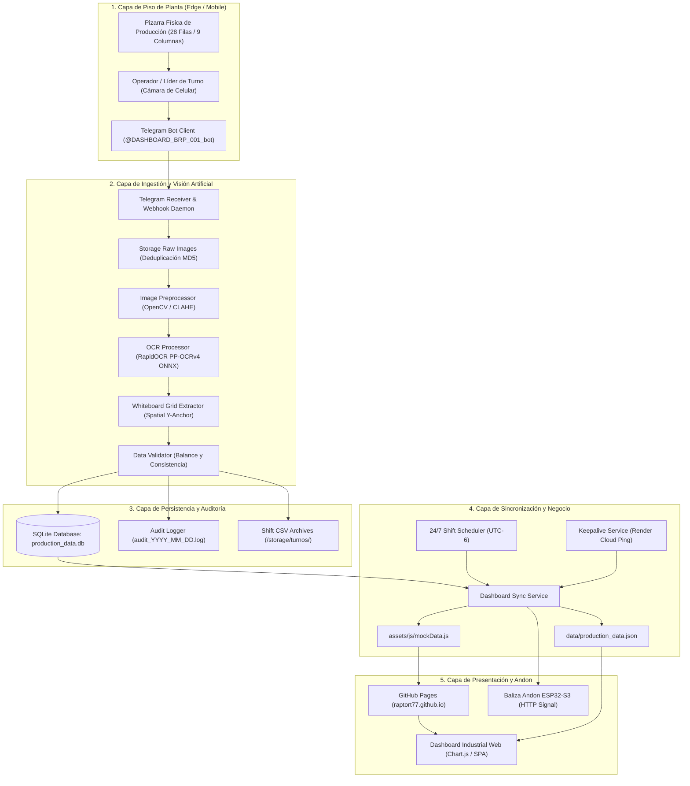
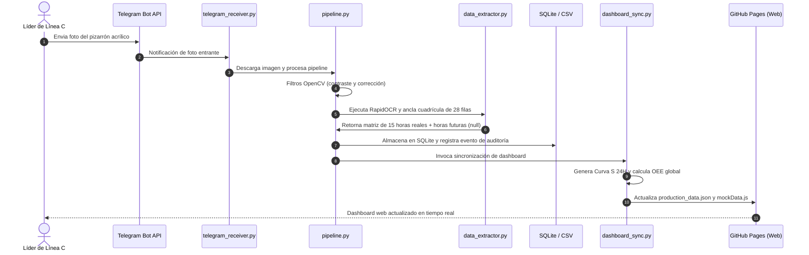
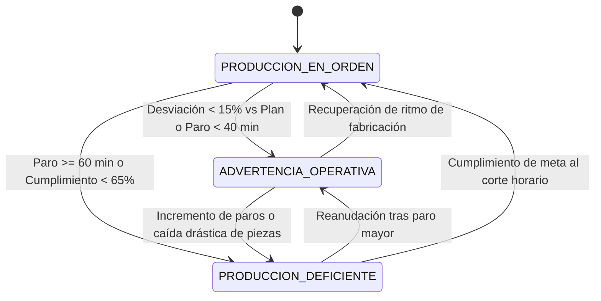

# ARCHITECTURE.md — Arquitectura Técnica del Sistema

> **BRP Rotax México — Planta Kolben Schmidt Celaya — Línea C**  
> **Sistema:** Telemetría, Captura OCR y Dashboard de Producción 24 Horas  
> **Referencia:** Arquitectura de 5 Capas

---

## 1. Diagrama General de Arquitectura (5 Capas)

---

## 2. Flujo Secuencial de Captura y Publicación

---

## 3. Máquina de Estados del Semáforo Andon

---

## 4. Descripción de Componentes Clave

### A. Preprocesamiento de Imágenes (`image_preprocessor.py`)
- **CLAHE (Contrast Limited Adaptive Histogram Equalization):** Realza el contraste de plumones gastados sobre fondo blanco reflectante.
- **Detección de Contorno de Pizarra:** Corrige la perspectiva para alinear el pizarrón ortogonalmente antes de segmentar.

### B. Motor OCR y Extractor Espacial (`ocr_processor.py`, `data_extractor.py`)
- **RapidOCR PP-OCRv4:** Reconoce con altísima velocidad (~150ms) trazos multiespectrales (BGR, canal verde para tinta morada, CLAHE para rojo y plumón gastado).
- Mapea las 28 filas de la plantilla oficial de Línea C:
  - 8 filas de Turno 1 (06:30 a 15:00) + Fila Totalizador T1.
  - 8 filas de Turno 2 (15:00 a 23:00) + Fila Totalizador T2.
  - 7 filas de Turno 3 (23:00 a 06:30) + Fila Totalizador T3.
  - Fila Total del Día (1,350 unidades programadas).
- Asigna tokens por coordenadas relativas X y asigna texto manuscrito a la columna de paros e incidencias.

### C. Sincronizador de Dashboard (`dashboard_sync.py`)
- Garantiza que el JSON maestro (`production_data.json`) y el archivo JS (`mockData.js`) sean réplicas exactas.
- Mantiene las horas futuras sin registrar con valores estrictamente `null` para que Chart.js las pinte en blanco.
- Calcula Disponibilidad, Rendimiento, Calidad (FPY) y OEE global bajo las fórmulas de World Class Manufacturing (WCM).
